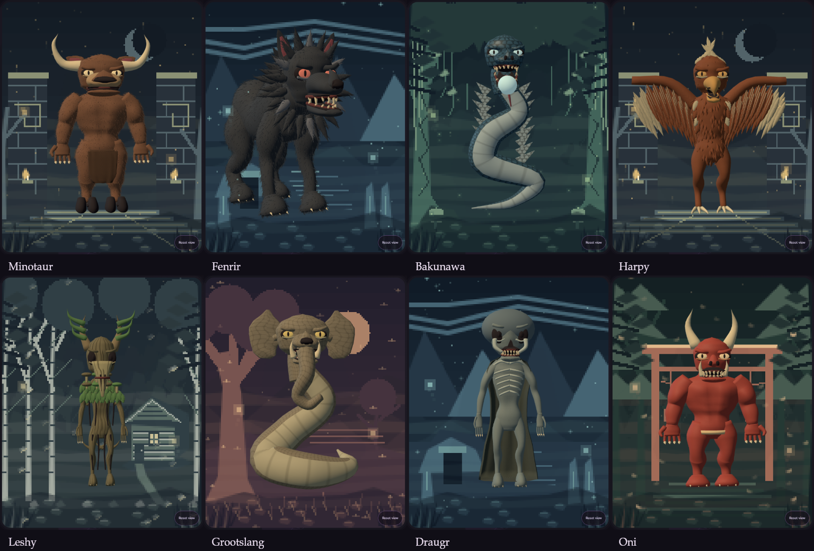

# Creature materials and focused interface — 23 October 2026

Continues the approved summon-only design. No search, catalog, mixer or gallery was added to the product.

## Implemented

- Circular cross-sections and welded seam normals replace squared organic contours. Skull profiles, canine muzzles, bull noses, rounded mandibles, cupped ears and smaller resting mouth openings distinguish the faces. The Minotaur rests with a closed mouth.
- Fur uses surface-area sampling to root curved, tapered hairs in each moving mesh. Geometry is batched per surface and follows the same joints. Eyes, noses, lips and palms remain clear. Birds have overlapping body plumage as well as flight feathers. Sampled portraits stay below 300,000 triangles; the nine-tailed fox is the largest tested at 292,628.
- Species select fur, overlapping scales, layered feathers, bark fissures, leathery hide, porous bone or skin. Clothing uses woven material. Each has separate color, relief and roughness maps; scales reflect more light while bark and fur stay matte. Painted atlas detail remains underneath the material grain. Bat/elephant surfaces use hide, dragons use scales. Serpents have separate transverse belly plates with smooth normals following their curves.
- V3 portraits render at 640 × 800 with antialiasing. Card export preserves this resolution and smooths larger images. V1/V2 genotype generation remains frozen.
- Mobile and desktop retain the name field, Summon, Surprise me, recent names, one example, and result actions. Summoning uses the same muted violet as the controls, a restrained diamond mark and small matching motes. Reduced motion suppresses movement.

## Evidence

- Full regression suite passed, including frozen versions, 2,500 ordered compositions, 50 primary/donor rigs, motion, anatomy, habitats, sharing, cards and 150 named individual variants.
- Surface checks cover all eight material fields, finite geometry, correct species assignments, rounded sections, rooted fur, triangle budgets and disposal of every material texture.
- TypeScript and the single-file production build pass.
- Real Chromium/WebGL checks cover 360 × 640, 390 × 844, 768 × 1024 and 1440 × 900 viewports, visible 44px action targets, no horizontal overflow, information-sheet dismissal, reduced motion and no runtime exceptions. These are headless checks; physical phone touch input and GPU frame rates were not measured.

[Desktop result](../artifacts/surface-refinement/desktop-result.png) · [Mobile result](../artifacts/surface-refinement/mobile-result.png) · [Mobile homepage](../artifacts/surface-refinement/mobile-home.png) · [Loading state](../artifacts/surface-refinement/desktop-loading.png)
